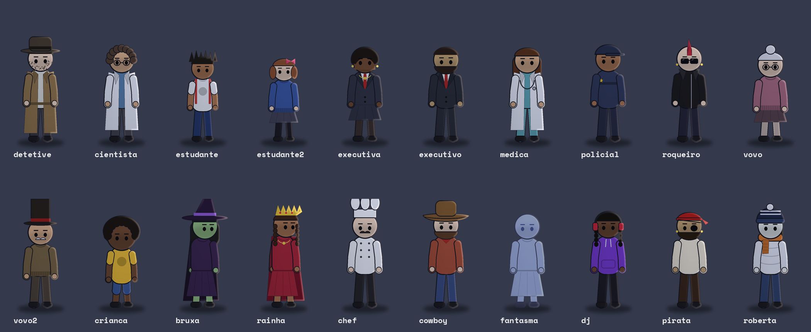
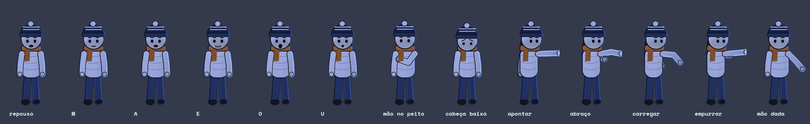

# Motor lo-fi · séries interativas em vídeo vertical

Motor de animação para séries curtas no formato **"escolha o caminho"** (Reels, TikTok, Shorts): no fim de cada episódio o público vota **A ou B** e a história segue pelo caminho escolhido.

Tudo é desenhado e animado por código, no estilo lo-fi flat: personagens expressivos com boca sincronizada à voz, câmera de cinema, cenários com luz e clima, legendas palavra por palavra, efeitos sonoros e trilha. Serve para qualquer gênero: suspense, terror, mistério, comédia, romance, fantasia, policial.




---

## Como usar no Claude (o jeito fácil)

O repositório vem com **5 skills** (pasta [`skills/`](skills/)) que fazem todo o trabalho por comando. Você não precisa mexer no código.

| Comando | O que você manda | O que recebe |
|---|---|---|
| `/serie-planejar` | A ideia da história | Plano da série, capa, bíblia e personagens travados |
| `/serie-roteiro` | Nada (o voto é escolhido por toque) | Roteiro de 2–3 min + narração pronta para o ElevenLabs |
| `/serie-continuar 2 B` | Só o comando (episódio que terminou + opção vencedora) | Voto registrado + roteiro do próximo episódio |
| `/serie-montar` | Um áudio por personagem | Vídeo, teaser de 15 s, capa e legenda do post |

### Ciclo de cada episódio
1. A votação fecha → `/serie-continuar 2 B`
2. Gere as vozes no ElevenLabs (um arquivo por personagem, com o nome do personagem: `roberta.mp3`, `rafa.mp3`)
3. `/serie-montar` com os áudios
4. Poste o vídeo e o teaser e fixe o comentário "Vota aqui: A ou B 👇"

### Instalar em outra conta do Claude
1. Baixe os `.zip` da pasta [`skills/`](skills/) e adicione cada um nas configurações de skills da conta (comece pela `serie-lofi-interativa`).
2. Conecte o GitHub na conta. Se este repositório for privado, a conta conectada precisa ter acesso a ele.
3. Pronto: as duas contas enxergam o mesmo motor e o mesmo progresso das séries.

---

## Continuidade: os personagens não mudam

Cada série tem uma pasta própria em `series/<nome-da-serie>/`:

| Arquivo | Para que serve |
|---|---|
| `biblia.md` | Mapa da série: mistério, finais, regras, cor de cada episódio, tabela de episódios (status e votos) e resumos |
| `personagens.json` | **Fichas travadas** de roupa, cabelo, pele e acessórios de cada personagem |
| `epNN_roteiro.md` | Roteiro completo do episódio NN |
| `epNN.json` | Roteiro técnico usado na montagem |

O `personagens.json` **sempre vence**: se um roteiro tentar redefinir um personagem, o motor ignora e usa a ficha travada, e o verificador avisa. Para mudar o visual de alguém de propósito (ex.: troca de roupa numa nova temporada), edite só esse arquivo.

Séries no repositório: [`series/dia-zero`](series/dia-zero/) (apocalipse zumbi, 5 episódios).

---

## O que o motor faz

**Personagens**
- 4 vistas (frente, costas, lado e **3/4**) e ações: andar, correr, pular, esconder, abrir porta, cair, rastejar, tremer
- 10 emoções com sobrancelhas, olhos e boca: neutro, medo, choque, raiva, tristeza, determinação, alegria, desconfiança, choro (com lágrimas) e ofegante
- Boca sincronizada com a voz **em formatos de vogal** (A, E, O, U, M), piscar, respiração, cabelo e cachecol balançando
- **Gestos automáticos pela fala**: aponta quando diz "ali", mão no peito em "eu", acena no "sim", balança a cabeça no "não", cabeça baixa em "desculpa"
- **Interações**: mãos dadas andando, carregar alguém no colo, abraço, empurrão
- Corpos: criança, idoso, alto, gordo, magro · objetos na mão: rádio, lanterna, celular, chave, mochila
- **Guarda-roupa** completo: 8 tons de pele, 14 tipos de roupa, saia/shorts/calça, 12 cabelos, barba e bigode, 12 chapéus, 12 acessórios, capa e modo fantasma
- **29 personagens prontos**: Roberta, Rafa, Lia, zumbis variados, soldado, detetive, cientista, estudantes, executivos, médica, policial, roqueiro, avós, criança, bruxa, rainha, chef, cowboy, fantasma, DJ, pirata

**Cenários (19)** — apartamento, entrada, corredor, rua, vista da janela, escada, telhado, ponte, rádio, hospital, mercado, metrô, escola, delegacia, posto de gasolina, floresta, interior de carro, esgoto, igreja
- Camadas em paralaxe, desfoque de fundo, névoa, chuva forte ou fraca, neve, nuvens, poças com ondinhas, hora do dia
- Detalhes vivos: ventilador girando, TV com chiado, cortina ao vento, sirene, limpador de para-brisa, velas

**Luz e câmera**
- Breu de verdade iluminado só pela lanterna, sombras projetadas na parede, relâmpagos, brilho nas luzes
- Close no rosto, plano por cima do ombro, travelling, foco seletivo, câmera na mão, vertigo, câmera lenta, tremor nos sustos
- Planos de detalhe: maçaneta girando, olho (pupila dilatando), celular, chave, relógio
- Transições: corte, whip, flash, fade, zoom, glitch · traço "desenhado à mão" e cor por episódio

**Narrativa e acabamento**
- Gancho de 2 s antes do título, "Anteriormente em…" com cenas do episódio anterior, carimbo "A MAIORIA ESCOLHEU", tela dividida A/B
- Legendas estilo Reels (palavra por palavra, destaque amarelo) que desviam do rosto dos personagens
- 25 efeitos sonoros sintetizados, ambiente automático por cenário e trilha de suspense
- **Eco por ambiente**: a voz reverbera na escada e na igreja, fica abafada dentro do carro

**Qualidade**
- Validador de roteiro (gancho, 12–20 cenas, A/B) e verificador de montagem (legenda no rosto, personagem cortado, ficha desrespeitada)
- Folha de revisão para um revisor independente aprovar antes do render
- Casos de teste das skills em [`tests/evals.json`](tests/evals.json)

**Extras automáticos**: teaser de 15 s para Stories, capa de cada episódio e compilação da temporada em 16:9 para o YouTube, com capítulos.

---

## Uso direto pelo terminal

```bash
pip install --break-system-packages pillow numpy scipy          # obrigatório, + ffmpeg
pip install --break-system-packages soundfile sherpa-onnx       # opcional (sem eles: scipy no áudio e transcrição só com tempos)

python3 -m lofi.transcribe roberta.mp3 rafa.mp3                # tempo de cada fala (baixa o Whisper na 1ª vez)
python3 tests/validar_roteiro.py series/dia-zero/ep03_roteiro.md   # confere o roteiro
python3 -m lofi.check  series/dia-zero/ep03.json               # verificador + folha _revisao.png
python3 -m lofi.render series/dia-zero/ep03.json --test 2 9    # quadros de teste
python3 -m lofi.render series/dia-zero/ep03.json --jobs 2      # vídeo final (~3,5 s por s de vídeo: episódio de 3 min ≈ 10–11 min)
python3 -m lofi.extras teaser series/dia-zero/ep03.json ep03.mp4
python3 -m lofi.extras capa   series/dia-zero/ep03.json
python3 -m lofi.extras temporada temporada.mp4 "DIA ZERO" ep1.mp4 ep2.mp4 ep3.mp4
```

O formato completo do roteiro técnico (planos, câmera, atores, guarda-roupa, sons) está em **[SPEC.md](SPEC.md)**; a lista de todos os nomes aceitos pelo motor está em **[CATALOGO.md](CATALOGO.md)**, gerada do código. Exemplos: [`examples/exemplo_roteiro.json`](examples/exemplo_roteiro.json) e [`examples/demo3/demo3.json`](examples/demo3/demo3.json).

## Estrutura

```
lofi/          código do motor
  rig.py         personagens (poses, emoções, guarda-roupa)
  scenes.py      cenários
  render.py      montagem do vídeo a partir do roteiro
  fx.py          chuva, luz, câmera, transições, estilo
  particles.py   poeira, lanterna, bafo de frio, hordas
  detail.py      planos de detalhe
  audio.py       efeitos sonoros e mixagem
  text.py        contador e legendas
  check.py       verificador de montagem
  extras.py      teaser, capa e temporada
  transcribe.py  transcrição das vozes
  catalogo.py    lista de nomes aceitos (gera o CATALOGO.md)
  wavio.py       leitura/escrita de áudio sem dependências extras
series/        uma pasta por série (bíblia, personagens travados, roteiros)
skills/        as 5 skills do Claude (SKILL.md + .zip gerado)
tools/         empacotar_skills.py (gera os .zip das skills)
.github/       CI: confere zips, catálogo, validador e verificador a cada push
tests/         validador de roteiro e casos de teste
examples/      roteiros de exemplo e imagens
```

Áudios e vídeos não são versionados.
